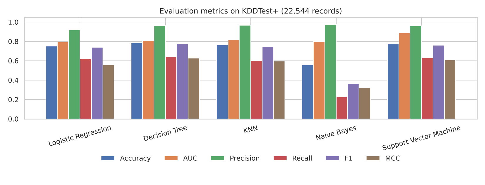
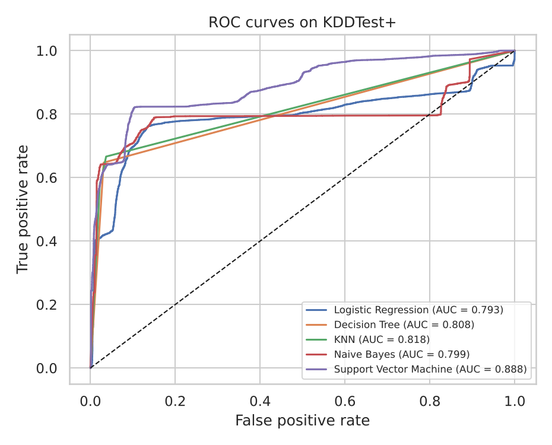
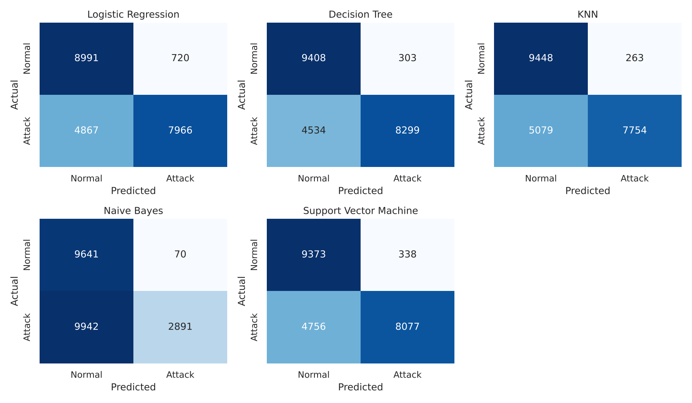

# Network Intrusion Detection on NSL-KDD (Five ML Classifiers + Streamlit App)

## a. Problem statement

Network intrusion detection: given the 41 traffic features describing a single network connection, decide whether it is **normal** traffic or an **attack**. This is a supervised binary classification problem on the NSL-KDD benchmark. Five classical machine learning models are trained on the same data and compared with six metrics (Accuracy, AUC, Precision, Recall, F1 and Matthews Correlation Coefficient), and the best model is exposed through a Streamlit web app.

## b. Dataset description

| Property | Details |
|---|---|
| Name / source | NSL-KDD (Tavallaee, Bagheri, Lu, Ghorbani, 2009), a cleaned version of KDD Cup 99. Public: UNB Canadian Institute for Cybersecurity (unb.ca/cic/datasets/nsl.html), Kaggle, Zenodo. |
| Files used | KDDTrain+.txt (training) and KDDTest+.txt (official hold-out test set) |
| Instances | 125,973 training records and 22,544 test records (minimum required: 500) |
| Features | 41 (38 numeric + 3 categorical: protocol_type, service, flag); 122 model inputs after one-hot encoding (minimum required: 12) |
| Feature groups | Basic connection features (duration, bytes, protocol), content features (failed logins, root shell, file creations), time-window traffic statistics (count, error rates) and host-based statistics (dst_host_*) |
| Target | Binary: 0 = normal, 1 = attack (any attack type). The training file also has the attack name; the test file has only Attack/Normal. |
| Class balance | Train: 53.5% normal / 46.5% attack. Test: 43.1% normal / 56.9% attack. |
| Training attack mix | Normal 67,343, DoS 45,927, Probe 11,656, R2L 995, U2R 52 (DoS = denial of service, Probe = scanning, R2L = remote-to-local, U2R = user-to-root) |
| Data quality | No missing values. 306 test records have the anonymised service value 'Attack4' (all are attacks); it never appears in training and is encoded as all zeros, so it cannot leak the label. |

## c. GitHub repository link

https://github.com/akaatish/2026AK05416-ML-ASSIGNMENT

Live Streamlit app: https://2026ak05416-ml-assignment.streamlit.app/

## d. Models used

All five models were trained on the same preprocessed NSL-KDD training data and evaluated on the official KDDTest+ set (Precision, Recall and F1 are for the attack class).

### Comparison table

| ML Model Name | Accuracy | AUC | Precision | Recall | F1 | MCC |
|---|---:|---:|---:|---:|---:|---:|
| Logistic Regression | 0.7522 | 0.7928 | 0.9171 | 0.6207 | 0.7404 | 0.5562 |
| Decision Tree | 0.7854 | 0.8079 | 0.9648 | 0.6467 | 0.7743 | 0.6274 |
| KNN | 0.7630 | 0.8179 | 0.9672 | 0.6042 | 0.7438 | 0.5970 |
| Naive Bayes | 0.5559 | 0.7989 | 0.9764 | 0.2253 | 0.3661 | 0.3197 |
| Support Vector Machine | 0.7740 | 0.8882 | 0.9598 | 0.6294 | 0.7603 | 0.6087 |







### Observations on model performance

| ML Model Name | Observation about model performance |
|---|---|
| Logistic Regression | Accuracy 0.7522 and MCC 0.5562, the lowest of the four reasonable models. As a linear model it cannot capture the non-linear structure of traffic features. It also has the lowest precision (0.9171, 720 false alarms) and misses about 38% of attacks (recall 0.6207). Very fast, and a sensible baseline. |
| Decision Tree | Best Accuracy (0.7854), F1 (0.7743) and MCC (0.6274). It fits the training data almost perfectly (depth 21, 231 leaves) yet still generalises best to KDDTest+. Precision is high (0.9648, 303 false alarms) and recall is the best among the non-Naive-Bayes models (0.6467). Interpretable, and trains in about two seconds. |
| KNN | Accuracy 0.7630, AUC 0.8179, precision 0.9672 (only 263 false alarms), but recall is the lowest after Naive Bayes (0.6042, with 5,079 attacks missed). Trained on a 20,000-row subsample only, and prediction is the slowest because every test record is compared with all stored training points. |
| Naive Bayes | Weakest by far: accuracy 0.5559, recall 0.2253, F1 0.3661, MCC 0.3197. It has the highest precision (0.9764, only 70 false alarms) but misses 77% of attacks. Its AUC (0.7989) is higher than its hard predictions suggest, so the ranking is reasonable but the 0.5 threshold is badly placed. The independence and Gaussian assumptions are violated by the strongly correlated rate features and the one-hot columns. |
| Support Vector Machine | Best AUC by a wide margin (0.8882), second-best Accuracy (0.7740), F1 (0.7603) and MCC (0.6087), with precision 0.9598. The RBF kernel separates attacks from normal traffic best in ranking terms, even though it was trained on only 20,000 rows; a tuned threshold would likely raise its recall. |

**Overall winner for this dataset: Decision Tree.** It leads on Accuracy, F1 and MCC (the most balanced single measure here) and is the simplest to explain and the cheapest to run. The **SVM is a close runner-up** and the best model if ranking quality (AUC) matters most.

**Common pattern.** Every model has high precision (0.92 to 0.98) but much lower recall (0.60 to 0.65, except Naive Bayes). This is the known difficulty of KDDTest+: its attack mix differs from KDDTrain+ (the NSL-KDD documentation notes attack types in the test set that are absent from training), so models detect familiar attacks well but miss novel ones. Accuracies around 75% to 79% are typical for this benchmark and should not be compared with the 99% figures often quoted from random splits of the training file.

**Limitations.** Metrics come from a single train/test split with default hyperparameters (no tuning); KNN and SVM are trained on a stratified 20,000-row subsample (the other three use all 125,973 rows); and the test file's binary labels do not allow a per-attack-type breakdown.

## Repository structure

```
2026AK05416-ML-ASSIGNMENT/
|-- app.py                          Streamlit app
|-- utils.py                        helper functions used by the app
|-- requirements.txt
|-- README.md
|-- test_data.csv                   KDDTest+ (22,544 records) for the app
|-- train_models.py                 trains and saves all five models
|-- common.py                       data loading + preprocessing used by train_models.py
|-- NSL_KDD_Classification.ipynb    full analysis notebook (EDA, models, metrics, plots)
|-- NSL_KDD_Report.pdf              report (this README content + figures)
|-- model/
|   |-- preprocessor.joblib         fitted scaler + one-hot encoder
|   |-- logistic_regression.joblib
|   |-- decision_tree.joblib
|   |-- knn.joblib
|   |-- naive_bayes.joblib
|   |-- support_vector_machine.joblib
|   |-- metrics.csv, feature_columns.json
|-- figures/                        plots used in the report
|-- data_raw/                       KDDTrain+.txt, KDDTest+.txt
```

## Run locally

```bash
pip install -r requirements.txt
streamlit run app.py                                   # launch the app
python train_models.py --train data_raw/KDDTrain+.txt --test data_raw/KDDTest+.txt   # optional: retrain
```

## Deploy on Streamlit Community Cloud

1. Push this repository to GitHub (branch **main**).
2. Go to https://streamlit.io/cloud and sign in with your GitHub account.
3. Click **New app**, select the repository and the **main** branch.
4. Set the main file path to **app.py** and click **Deploy**.

## Preprocessing summary

- 38 numeric features standardised (`StandardScaler`); 3 categorical features one-hot encoded (`handle_unknown="ignore"`), giving 122 inputs.
- Preprocessing is fit on the training set only. KNN and SVM use a stratified 20,000-row training subsample for speed and to keep the saved model files small.
- Hyperparameters: Logistic Regression (max_iter=1000), Decision Tree (defaults), KNN (k=5), Gaussian Naive Bayes (defaults), SVM (RBF, C=1, gamma="scale"); random_state=42.
- Environment used: Python 3.12, scikit-learn 1.9.1.

## Reference

M. Tavallaee, E. Bagheri, W. Lu, A. A. Ghorbani, "A detailed analysis of the KDD CUP 99 data set," IEEE CISDA, 2009.
